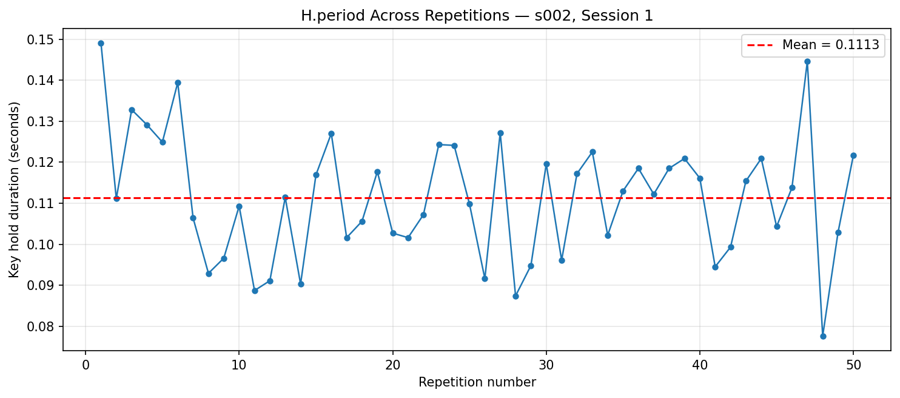
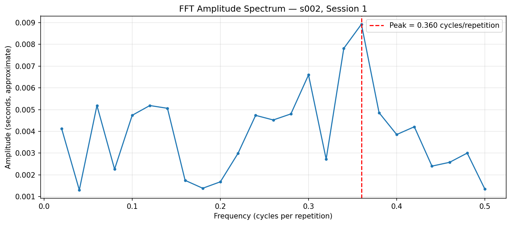

# ⌨️ Keyboard Interaction Time-Series Analysis

<p align="center">
  <b>Understanding Keystroke Timing Through Statistics and Signal Processing</b>
  <br><br>
  
  
  
  
</p>

---

## 📌 Table of Contents
- [About the Project](#-about-the-project)
- [Research Question](#-research-question)
- [Dataset](#-dataset)
- [Analysis Workflow](#-analysis-workflow)
- [Results and Findings](#-results-and-findings)
- [Visualizations](#-visualizations)
- [Project Structure](#-project-structure)
- [Installation and Execution](#-installation-and-execution)
- [Limitations](#-limitations)
- [Future Improvements](#-future-improvements)
- [Attribution and License](#-attribution-and-license)

---

## 🔍 About the Project

**Keyboard Interaction Time-Series Analysis** is a small Human-Computer Interaction (HCI) lab project that studies variations in keyboard timing measurements using Python.

The project uses the **CMU Keystroke Dynamics Benchmark** to analyze how long a key is held down across repeated typing trials.

Two complementary analytical methods are used:

<table>
  <tr>
    <td width="50%" valign="top">
      <h3>📊 Time-Domain Analysis</h3>
      Examines the measurements directly using descriptive statistics:
      <ul>
        <li>Mean hold duration</li>
        <li>Standard deviation</li>
        <li>Minimum and maximum</li>
        <li>Median</li>
        <li>Variation across repetitions</li>
      </ul>
    </td>
    <td width="50%" valign="top">
      <h3>📈 Frequency-Domain Analysis</h3>
      Uses the Fast Fourier Transform (FFT) to investigate variation across the ordered sequence:
      <ul>
        <li>Linear detrending</li>
        <li>Hann windowing</li>
        <li>FFT amplitude spectrum</li>
        <li>Dominant nonzero frequency</li>
        <li>Approximate spectral period</li>
      </ul>
    </td>
  </tr>
</table>

> **Main Objective:** Learn how statistical analysis, visualization, and signal-processing techniques can be applied to keyboard interaction data.  
> *This project is for educational and analytical purposes. It does not implement a keystroke-based authentication system.*

---

## 🎯 Research Question

> *How can time-domain statistics and frequency-domain analysis characterize variation in a keyboard timing feature across repeated typing trials?*

The analysis focuses on the hold duration of the **period (`.`) key** (`H.period`) for **one participant in one session**.

---

## 📁 Dataset

### CMU Keystroke Dynamics Benchmark
The dataset was developed for research into keystroke dynamics and contains:

| Dataset Property | Description |
| :--- | :--- |
| **Total Records** | 20,400 |
| **Participants** | 51 |
| **Sessions per Participant** | 8 |
| **Repetitions per Participant** | 400 |
| **Repetitions per Session** | 50 |
| **File Format** | CSV |

### Features Used
| Feature | Meaning |
| :--- | :--- |
| `subject` | Identifies the participant |
| `sessionIndex` | Identifies the session |
| `rep` | Repetition number within a session |
| `H.period` | Hold duration of the period key |

### Dataset Installation
The dataset is **not** included in this repository. Download it from the official CMU dataset source and place it at:

```text
data/DSL-StrongPasswordData.csv
```

*The analysis expects this exact filename and location. Dataset attribution and reuse must follow the original source's terms.*

---

## ⚙️ Analysis Workflow

The notebook follows a reproducible sequence of data preparation, statistical analysis, signal processing, and visualization.

<p align="center">
  <b>Load Dataset</b><br>
  ↓<br>
  <b>Select Participant and Session</b><br>
  ↓<br>
  <b>Extract H.period Measurements</b><br>
  ↓<br>
  <b>Time-Domain Statistics</b><br>
  ↓<br>
  <b>Detrending → Hann Window → FFT</b><br>
  ↓<br>
  <b>Generate and Save Visualizations</b>
</p>

### 1. Data Preparation
The dataset is loaded using Pandas. The notebook selects:
- **Participant:** `s002`
- **Session:** `1`
- **Feature:** `H.period`
- **Observations:** `50`
- **Repetition range:** `1–50`

The observations are sorted by repetition number, and missing feature values are checked.

### 2. Time-Domain Analysis
The selected hold durations are summarized using descriptive statistics. The mean represents the average hold duration, while the standard deviation describes how much the measurements vary around the mean. The minimum, maximum, and median provide additional information about the distribution.

A line plot displays the measurements in repetition order, with a horizontal line indicating the mean.
- **Generated file:** `outputs/time_domain_H_period.png`

### 3. Frequency-Domain Analysis
The ordered sequence is processed using SciPy and NumPy:

| Processing Step | Purpose |
| :--- | :--- |
| **Linear detrending** | Removes the estimated linear trend |
| **Hann window** | Reduces spectral leakage |
| **Real FFT (`rfft`)** | Computes the frequency-domain representation |
| **Frequency bins (`rfftfreq`)** | Identifies the corresponding frequencies |
| **Amplitude calculation** | Estimates the strength of spectral components |
| **Peak detection** | Finds the strongest nonzero component |

The frequency with the highest nonzero amplitude is selected, and its reciprocal is used to calculate the approximate period in repetitions.
- **Generated file:** `outputs/fft_H_period.png`

> ⚠️ **Important:** These observations are indexed by password repetition, not by uniformly sampled continuous time. Consequently, frequency is expressed in **cycles per repetition**, not hertz. A spectral peak does not prove the existence of a continuous typing rhythm or stable behavioral cycle.

---

## 📊 Results and Findings

The following results were obtained from participant `s002`, session `1`.

### Time-Domain Results
| Metric | Result |
| :--- | --: |
| **Number of observations** | 50 |
| **Mean hold duration** | **111.288 ms** |
| **Standard deviation** | 15.222 ms |
| **Minimum hold duration** | 77.600 ms |
| **Maximum hold duration** | 149.100 ms |
| **Median hold duration** | 111.800 ms |

* **Interpretation:** The average hold duration was approximately $111.3\text{ ms}$. The standard deviation of approximately $15.2\text{ ms}$ indicates variation in hold duration across the selected repetitions.

### Frequency-Domain Results
| Metric | Result |
| :--- | --: |
| **Frequency resolution** | 0.0200 cycles/repetition |
| **Dominant nonzero frequency** | **0.3600 cycles/repetition** |
| **Approximate spectral period** | 2.78 repetitions |
| **Peak amplitude** | 0.008922 s (approx.) |

* **Interpretation:** The strongest nonzero spectral component occurred at $0.36\text{ cycles per repetition}$, corresponding to an approximate period of $2.78\text{ repetitions}$.  
*This is an exploratory result based on a short sequence. It should not be interpreted as evidence that the participant exhibits a stable typing rhythm.*

---

## 📈 Visualizations

The notebook generates two PNG figures and saves them in the `outputs/` directory.

### 1. Time-Domain Plot
<p align="center">
  
</p>
<p align="center">
  <b>Figure 1.</b> Period-key hold duration across 50 repetitions.
</p>

The plot shows how the hold duration changes from one repetition to the next. The red dashed line indicates the mean, making it easier to compare individual measurements with the overall average.
- **File:** `outputs/time_domain_H_period.png`

### 2. Frequency-Domain Plot
<p align="center">
  
</p>
<p align="center">
  <b>Figure 2.</b> One-sided FFT amplitude spectrum after detrending and Hann windowing.
</p>

The spectrum shows the distribution of variation across repetition-order frequencies. The highlighted peak identifies the strongest nonzero component in the analyzed sequence.
- **File:** `outputs/fft_H_period.png`

*Note: The plots will appear here on GitHub when the image files are present at the specified repository paths.*

---

## 🗂️ Project Structure

```text
Keyboard_interaction/
│
├── data/
│   └── DSL-StrongPasswordData.csv
│
├── notebooks/
│   └── time_series_analysis.ipynb
│
├── outputs/
│   ├── time_domain_H_period.png
│   └── fft_H_period.png
│
├── src/
│   └── inspect_data.py
│
├── .gitignore
├── README.md
└── requirements.txt
```

| File or Directory | Purpose |
| :--- | :--- |
| `data/` | Stores the locally downloaded dataset |
| `notebooks/` | Contains the analysis notebook |
| `outputs/` | Stores generated plots |
| `src/` | Contains supporting Python scripts |
| `.gitignore` | Specifies files excluded from version control |
| `requirements.txt` | Lists Python dependencies |
| `README.md` | Provides project documentation |

*Keep the dataset out of version control unless its redistribution terms have been verified.*

---

## 🚀 Installation and Execution

### Prerequisites
- Python 3.12 or a compatible Python version
- `pip`
- Jupyter Notebook

### Step 1: Open the Project Directory
On Windows, open Command Prompt and run:
```cmd
cd /d "C:\HCI LAB\Keyboard_interaction"
```
*(Change the path if your project is stored elsewhere.)*

### Step 2: Install Dependencies
```cmd
python -m pip install -r requirements.txt
```

If you do not already have a `requirements.txt` file, create one containing:
```text
pandas
numpy
matplotlib
scipy
jupyter
ipykernel
```

### Step 3: Launch Jupyter Notebook
```cmd
python -m jupyter notebook
```

### Step 4: Open the Notebook
Open this file in Jupyter:
```text
notebooks/time_series_analysis.ipynb
```
Run the notebook cells from top to bottom.

### Expected Outputs
After a successful run, the following files should exist:
```text
outputs/
├── time_domain_H_period.png
└── fft_H_period.png
```
The notebook also prints the descriptive statistics, dominant FFT frequency, approximate spectral period, and output-file verification results.

---

## ⚠️ Limitations

- **Small analysis sample:** Only one participant, one session, and 50 repetitions are analyzed in detail.
- **Limited generalizability:** Results cannot represent all participants or keyboard interactions.
- **Repetition-order sampling:** The sequence is not a continuous-time signal sampled at uniform time intervals.
- **Exploratory frequency analysis:** A dominant spectral component does not establish a stable behavioral cycle.
- **Preprocessing sensitivity:** Results may depend on the selected feature, detrending, windowing, and participant.
- **No authentication evaluation:** The project does not train or test a keystroke authentication model.

*The findings should be treated as an educational demonstration of statistical analysis and signal processing.*

---

## 🔮 Future Improvements

- Compare multiple sessions for the same participant.
- Analyze multiple participants to study between-person variation.
- Investigate additional hold-time and digraph timing features.
- Compare distributions using histograms and box plots.
- Examine spectral stability across longer sequences.
- Compare different detrending and windowing methods.
- Automate the analysis across participants and sessions.
- Add data validation and automated tests.

---

## 📚 Attribution and License

- **Dataset:** CMU Keystroke Dynamics Benchmark.
- **Usage:** This project uses the benchmark for an educational analysis involving descriptive statistics, time-series visualization, and FFT. It is not a reproduction of the benchmark's original anomaly-detection evaluation.
- **License Note:** Consult the original CMU documentation for the appropriate dataset citation and reuse terms. Code license is not yet specified. The analysis code and the dataset may be subject to different licensing terms. Do not assume that permission to use one automatically grants permission to redistribute the other.

---

<p align="center">
  <b>⌨️ Human-Computer Interaction Lab Project</b><br>
  <sub>Built with Python, Pandas, NumPy, SciPy, Matplotlib, and Jupyter Notebook.</sub>
</p>
